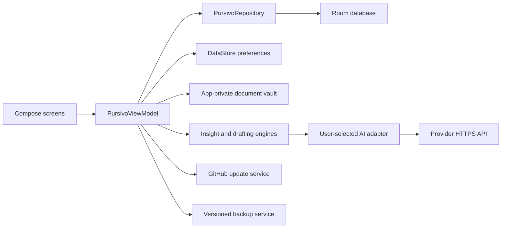

# Architecture

## Runtime boundaries

Pursivo is a single-process Android application with five Gradle modules. Compose renders immutable `PursivoUiState`; `PursivoViewModel` translates user intent into repository, AI, backup, and updater calls. Room is authoritative for structured user data, DataStore owns small preferences and updater metadata, and the app-private vault owns document bytes.

No network request originates from repositories, database observers, or UI rendering. Provider calls are foreground operations reached only from the Studio or explicit daily-brief action. The updater runs on a foreground launch at most once per 24 hours or by manual request.

## Data model

`JobApplication` references a `PipelineStage`. A stage has an editable label, order, color and visibility, but its `semanticKind` remains the analytics contract. A rename therefore never changes historical or aggregate meanings. `ApplicationEvent` is append-only from feature code and records creation, stage transitions, tasks, documents, notes and AI activity.

`ProviderConfig` contains display metadata and a random credential alias only. `SecretStore` maps that alias to AES-GCM ciphertext whose key is generated inside Android Keystore. `AiInsight` persists model, provider, prompt version, context summary, validated output and acceptance state; it never contains the provider key.

## AI trust boundary

`AiContext.preview()` is the user-visible representation of selected application, profile and optional document evidence. Both engines instruct models to use supplied evidence only. Provider responses must decode into the expected Kotlin-serialization schema before persistence. Missing facts remain in `missingInformation` or `placeholders`. No AI response mutates an application or stage.

## Backup contract

`pursivo-backup-v1.zip` contains a versioned JSON manifest plus referenced vault files. Restore extracts to a temporary app-private directory, validates schema and paths, then replaces Room content transactionally. Credentials are deliberately omitted. Newer schema versions fail closed.

## Update contract

The app queries public GitHub release metadata. Stable ignores prereleases; prerelease accepts the newest higher valid SemVer. Releases can expose an APK URL, SHA-256 and size through the generated update manifest. Android package installation always requires operating-system approval.
